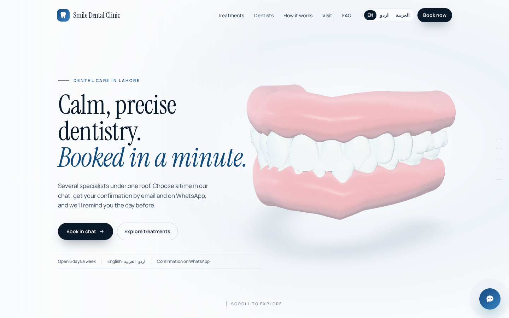
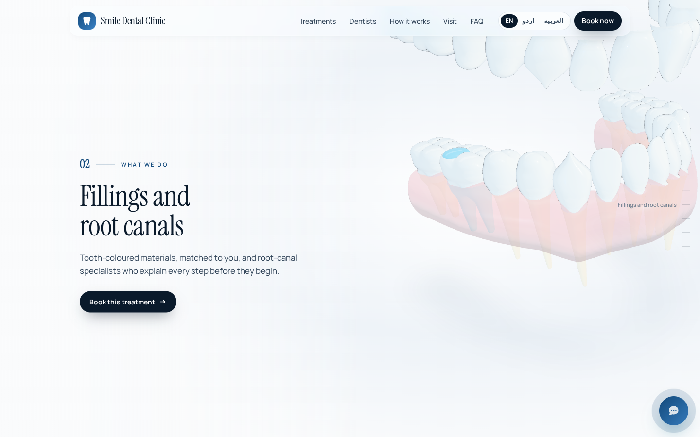
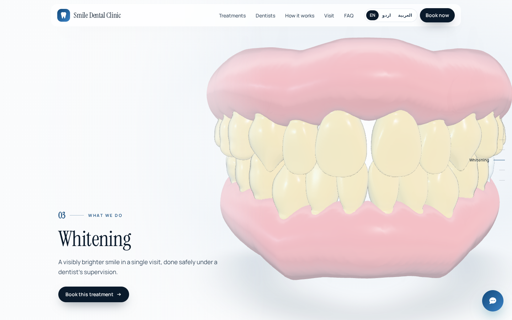
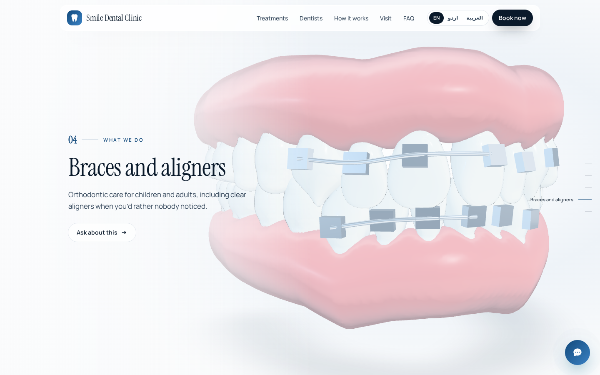
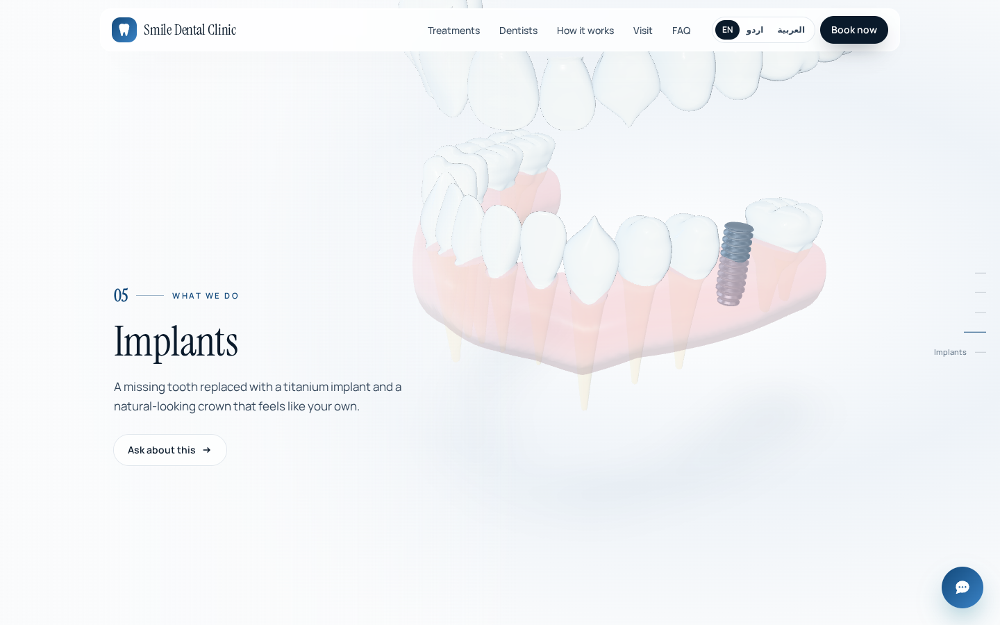
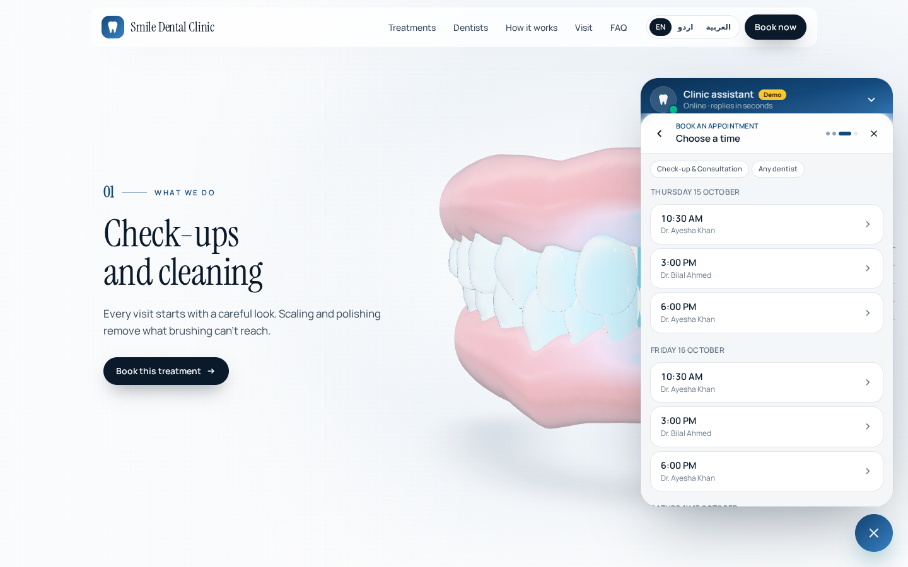
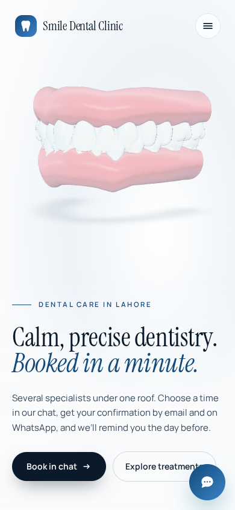
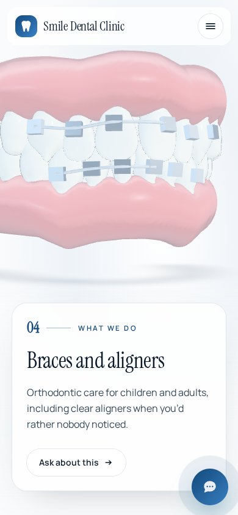
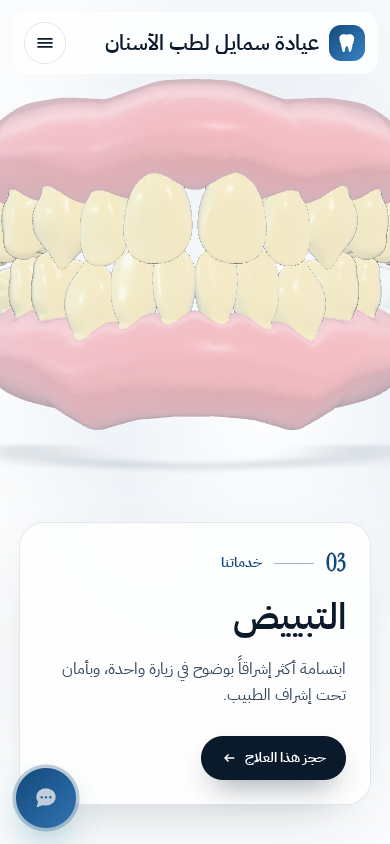
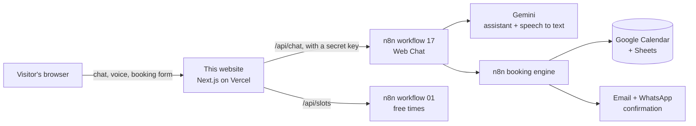

# DentalFlow · Clinic website with a 3D scroll story and an AI booking assistant

A website for a dental clinic where visitors **scroll through a 3D model of a mouth** to see each treatment, then **book an appointment in a chat**, in English, Urdu or Arabic, by typing, tapping or sending a voice note. Bookings land in the clinic's Google Calendar and Sheets, and the patient gets a confirmation **by email and on WhatsApp**.



> The clinic on the page ("Smile Dental Clinic", Lahore) is a demo with sample prices, dentists and phone numbers. Everything about the clinic lives in one file, `content/clinic.ts`.

---

## What it does

### 1. The 3D scroll story
The mouth model stays on screen while six panels scroll past. The camera flies to the teeth each panel talks about, and the treatment plays out on the model as you scroll:

| Fillings and root canals | Whitening |
|---|---|
|  |  |
| The jaw opens, the gums turn see-through, the molar's roots light up and a filling appears. | The front teeth start stained and turn white as you scroll. |
| **Braces and aligners** | **Implants** |
|  |  |
| Brackets click onto the teeth one by one and the wire draws through them. | The old tooth fades, a titanium screw turns in, then an abutment and a new crown follow. |

The model (28 teeth in two gums) is generated by code in `scripts/make-mouth.mjs`: no 3D files were bought or downloaded. It is a compressed 1.6 MB `.glb` file.

### 2. The booking assistant
The chat in the corner is the same assistant the clinic uses on WhatsApp. Visitors can:

- **tap to book**: treatment → dentist → a list of real free times → name, mobile and email → confirm;
- **type** questions in English, Urdu or Arabic (prices, hours, location, parking…);
- **send a voice note**, which is transcribed and answered.



Every booking is re-checked against the live calendar before it is confirmed. The patient then receives an email and a WhatsApp message with the reference number.

### 3. Three languages, any screen
English, Urdu (Nastaliq) and Arabic, with a full right-to-left layout. On phones the model sits above the text.

| English | Braces stage | Arabic (right to left) |
|---|---|---|
|  |  |  |

---

## How it works



- The browser only talks to this website. The website's own server adds the secret key and forwards messages to **n8n**, so the key and the n8n address never appear on the page.
- **n8n** runs the assistant (Gemini), reads the clinic's dentists, prices and free times, books, and sends the confirmations. The n8n workflows are part of the DentalFlow project and are not in this repository.
- Without the n8n settings, the site runs in **demo mode**: the chat gives scripted answers and nothing is booked, so the site can be tried on its own.

## Built with

Next.js 16 (App Router) · React 19 · TypeScript · Tailwind CSS 4 · Three.js with React Three Fiber and drei · Motion (scroll animation) · self-hosted fonts (Instrument Serif, Manrope, IBM Plex Sans Arabic, Noto Nastaliq Urdu) · n8n · Google Gemini · Google Calendar and Sheets · WhatsApp Cloud API.

---

## Run it on your computer

You need **Node.js 20 or newer**.

```bash
npm install
npm run dev
```

Open <http://localhost:3000>. With no settings, the chat runs in demo mode.

To connect it to n8n, copy `.env.example` to `.env.local` and fill in:

| Setting | What it is |
|---|---|
| `N8N_WEB_CHAT_URL` | the production webhook of n8n workflow 17, e.g. `https://your-n8n-address/webhook/web-chat` |
| `N8N_WEB_CHAT_KEY` | the secret value of the "DentalFlow web key" Header Auth credential in n8n |

`.env.local` is in `.gitignore`: never commit it.

## Put it online (Vercel)

1. On vercel.com: **Add New → Project**, then import this repository. Vercel detects Next.js by itself. The project name must be lowercase (for example `smile-dental-clinic`).
2. Under **Environment Variables**, add `N8N_WEB_CHAT_URL` and `N8N_WEB_CHAT_KEY`. The URL must be a public address of n8n (a domain or an ngrok address), not `localhost`.
3. **Deploy.** Every later `git push` updates the live site.

n8n must be running and reachable for the chat to answer. When it isn't, the chat says it cannot reach the clinic and shows the clinic's phone number.

## Make it your clinic's

| File | What to change |
|---|---|
| `content/clinic.ts` | name, city, phone, WhatsApp, address, map link, opening hours, treatments and prices, dentists, FAQ (in three languages) |
| `lib/i18n.ts` | every other word on the page, in three languages |
| `app/globals.css` | the colours (top of the file) |
| `components/three/MouthScene.tsx` | camera viewpoints (`KEYS`), tooth and gum colours, and the scroll range of each animation |
| `scripts/make-mouth.mjs` | tooth sizes and gums; run `node scripts/make-mouth.mjs` to rebuild `public/models/mouth.glb` |

## Project layout

```
app/[lang]/page.tsx        the page (/en, /ur, /ar)
app/api/chat/route.ts      passes chat messages and voice notes to n8n; holds the secret key
app/api/slots/route.ts     free times for the booking panel
components/sections/       the 3D scroll story (Experience.tsx), treatments, dentists, visit, FAQ
components/three/          the 3D mouth scene
components/chat/           the chat window, booking panel and voice recorder
content/clinic.ts          the clinic's details
lib/i18n.ts                all texts in English, Urdu and Arabic
public/models/mouth.glb    the 3D model
scripts/make-mouth.mjs     makes the 3D model
docs/screenshots/          the pictures in this file
```

## Safety and privacy

- The n8n key stays on the server. The chat route only accepts requests from the site itself and limits each visitor to 12 messages a minute and 150 a day.
- Voice notes are converted in the browser, sent once for transcription and never stored by the website.
- The chat is kept only in the visitor's own browser for 24 hours, so a reload doesn't lose it; **Start over** clears it.
- Visitors who ask their device for less motion get a still model; devices without 3D support get a drawing instead.
